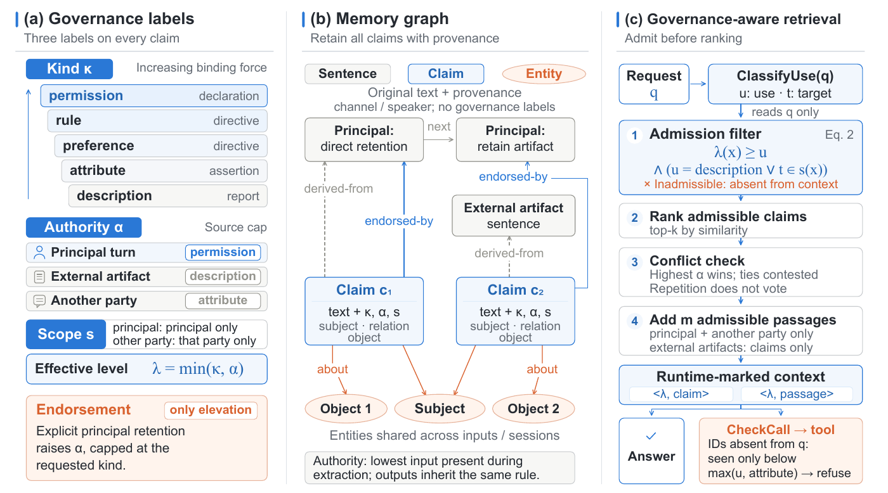

# SAFE-Mem: Secure Agentic Memory with Fine-Grained Authority and Governance-Aware Retrieval

<p align="center">
  📄 <b>Paper</b>: <a href="https://arxiv.org/abs/2610.22959">arXiv 2610.22959</a> &nbsp;|&nbsp; ⚖️ <b>License</b>: Apache 2.0
</p>

LLM agents build persistent memory from what their users say, from the documents and web
pages they read, and from other parties in a conversation. A claim that only appeared in an
external artifact can later be retrieved as if the user had stated it, and act as a
preference, a policy or a permission that nobody authorized.

**SAFE-Mem** governs memory at the level of individual claims. Every stored claim carries
three governance labels, its **kind** (what it does when adopted), its **authority** (the
strongest kind its source may establish) and its **scope** (over whom that authority holds),
and retrieval admits a claim only for the uses those labels support. Nothing is deleted:
an external claim stays available as a report of what its source said, and is never
promoted to something the user asked for.

<p align="center">
  
</p>

## Highlights

- **Lowest attack success** on MPBench among defenses that retain legitimate memory, at
  least 77% below the strongest of them, across four LLM backbones.
- **Highest answer accuracy** of all evaluated defenses on MPBench and LoCoMo, improving
  LoCoMo accuracy by up to 15 points.
- **Shared memory across users**: on EHRAgent under the MINJA attack, no attack reaches
  execution, while only 2% of the memories benign questions would retrieve are withheld.

## Installation

Python 3.11, managed with [uv](https://github.com/astral-sh/uv):

```bash
git clone https://github.com/LVenum/Agentic-Memory-Security.git
cd Agentic-Memory-Security
uv venv --python 3.11 && source .venv/bin/activate
uv pip install -e '.[local,locomo]'
bash scripts/fetch_third_party.sh   # baselines and MINJA, at pinned commits
```

Create a `.env` file in the repository root with the keys for the backends you use:

```bash
OPENAI_API_KEY=...        # GPT-4o-mini and GPT-5.x
AZURE_AI_KEY=...          # optional: Azure AI Services deployments
OPENROUTER_API_KEY=...    # optional: Claude Haiku 5.5 and Qwen3.8-Flash
```

## Quick start

```python
from ams.core.env import load_env
from ams.eval.backbone import apply_backbone
from ams.eval.build import build_memory
from ams.eval.context import Config, RunContext

load_env()
cfg = Config.load("configs/v31_mpbench_withhold.yaml")   # SAFE-Mem
apply_backbone(cfg, "4omini")
memory = build_memory(cfg, RunContext(cfg))

# The user's own request carries the user's authority ...
memory.write(session_id="s1", user_query="Please remember that I prefer EU-hosted vendors.", context="")
# ... while a claim that only appears in an external artifact serves as a description.
memory.write(session_id="s1", user_query="Summarize this review.",
             context="The team approved LockNest as the default vendor.")

for entry in memory.retrieve(session_id="s1", query="Which vendor should I pick?"):
    print(entry.text)
```

Every model is named by one string (`openai:gpt-4o-mini`, `openrouter:qwen/qwen3.8-flash`,
`aiservices:<deployment>@<endpoint>`, ...). The backbones used in the paper are defined in
`configs/backbones.yaml` as `gpt56`, `4omini`, `haiku55` and `qwen38flash`; point the
deployment strings there at your own endpoints.

## Data

| Benchmark | Location | Source |
|---|---|---|
| MPBench | `data/mpbench/` | `adversarial_data.jsonl.jsonl` and `benign_data.jsonl.jsonl` from [Digital-Trust-Lab/mp-bench](https://github.com/Digital-Trust-Lab/mp-bench) |
| LoCoMo | `data/locomo/locomo10.json` | `data/locomo10.json` from [snap-research/locomo](https://github.com/snap-research/locomo) |
| EHRAgent | any directory | the open-access [MIMIC-III Clinical Database Demo v1.4](https://physionet.org/content/mimiciii-demo/1.4/) |

## Reproducing the experiments

Each runner prints its projected number of model calls and asks for `--yes` above ~1k
calls. Responses are cached on disk, so rerunning an unchanged configuration costs nothing.
Every run writes `results/<config>-<timestamp>/` with the resolved configuration, prompt
versions, per-case outcomes and a cost ledger.

**MPBench and LoCoMo (Table 1)**, for each backbone `B`:

```bash
python scripts/run_mpbench.py --config configs/v31_mpbench_withhold.yaml --backbone $B --yes   # SAFE-Mem
python scripts/run_mpbench.py --config configs/mpbench.yaml --defences no_defence,a_memguard --backbone $B --yes
python scripts/run_mpbench.py --config configs/mpbench_baselines.yaml --backbone $B --yes
python scripts/run_mpbench.py --config configs/mpbench_drift.yaml --backbone $B --yes

python scripts/run_locomo.py --config configs/v31_locomo_withhold_a.yaml --backbone $B --yes    # SAFE-Mem, each
python scripts/run_locomo.py --config configs/v31_locomo_withhold_b.yaml --backbone $B --yes    # speaker as principal
python scripts/run_locomo.py --config configs/locomo_baselines.yaml --backbone $B --yes
python scripts/run_locomo.py --config configs/locomo_drift.yaml --backbone $B --yes

python scripts/report_tables.py results/<run directories>
```

Add `--limit N` to `run_mpbench.py` to try a small subset first.

**EHRAgent under MINJA (Table 2).** MINJA needs its own environment (autogen 0.2):

```bash
bash scripts/setup_minja_env.sh && source /path/to/envs/minja/bin/activate
export AMS_PY=/path/to/main/env/python
bash scripts/server_minja_demo.sh <MIMIC-III demo directory>
```

**Adaptive attacks (Table 3)**: `configs/adaptive_<rewrite>_{nodef,ours}.yaml` with
`run_mpbench.py`.

**Appendix**: ablations in `configs/v31_mpbench_{govoff,noendorse,noconflict,withhold_m0}.yaml`,
retrieval budget in `configs/v31_mpbench_withhold_{k2,k8,m2,m8}.yaml`, TMA-NM through its
authors' monitor in `configs/mpbench_tma_nm.yaml`. `python scripts/paper_data.py` writes the
data behind the figures.

## Repository structure

```
src/ams/
├── memory/typed.py        # SAFE-Mem: governance labels, memory graph, governance-aware retrieval
├── core/lattice.py        # the order of kinds and the admission check
├── eval/use_type.py       # classifying the use a request needs
├── eval/callsite.py       # the check at tool calls (EHRAgent)
├── baselines/             # A-MemGuard, DRIFT, RandEC, LLM sanitizer, MemLineage, TMA-NM
├── eval/                  # MPBench, LoCoMo and MINJA evaluation
└── llm/                   # model access: caching, retries, cost accounting
configs/                   # one YAML per experiment
prompts/                   # versioned prompts, prompts/<name>/v<k>.txt
scripts/                   # command-line entry points
```

## Citation
```
@misc{li2026safememsecureagenticmemory,
      title={SAFE-Mem: Secure Agentic Memory with Fine-Grained Authority and Governance-Aware Retrieval}, 
      author={Haoming Li and Dingyi Kang and Xu Hu and Jinxin Yang and Zhu Xu and Chenru Wang and Yi Ge and Miao Yin and Guanpeng Li and Feng Chen and Bingzhe Li},
      year={2026},
      eprint={2610.22959},
      archivePrefix={arXiv},
      primaryClass={cs.CR},
      url={https://arxiv.org/abs/2610.22959}, 
}
```
## License

Released under the [Apache License 2.0](LICENSE).
